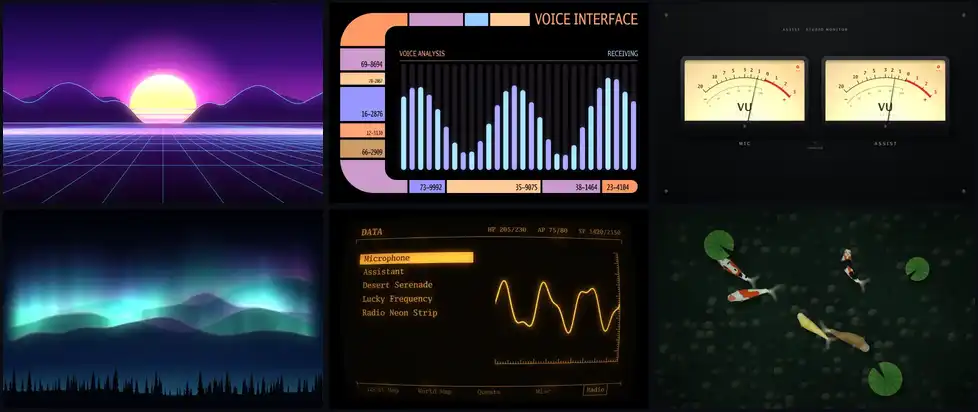
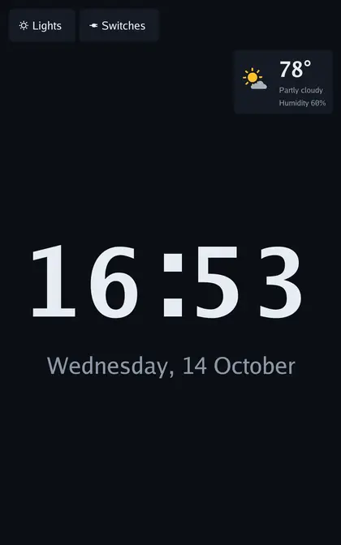
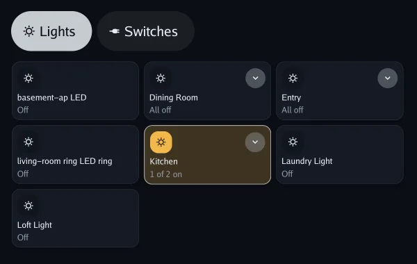
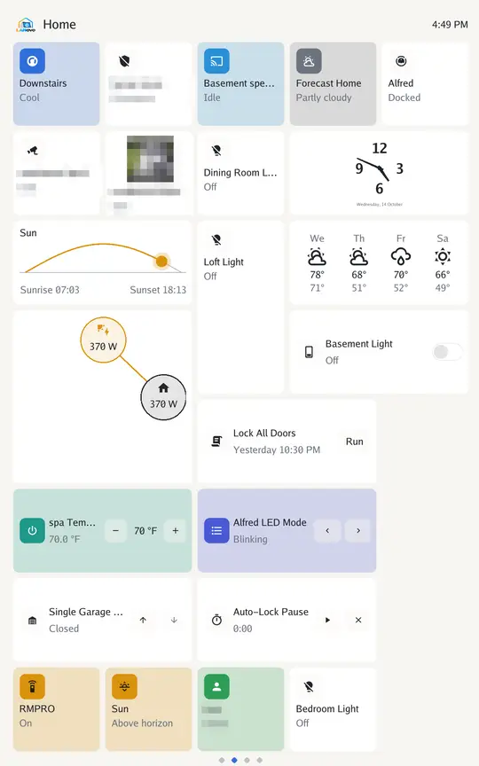
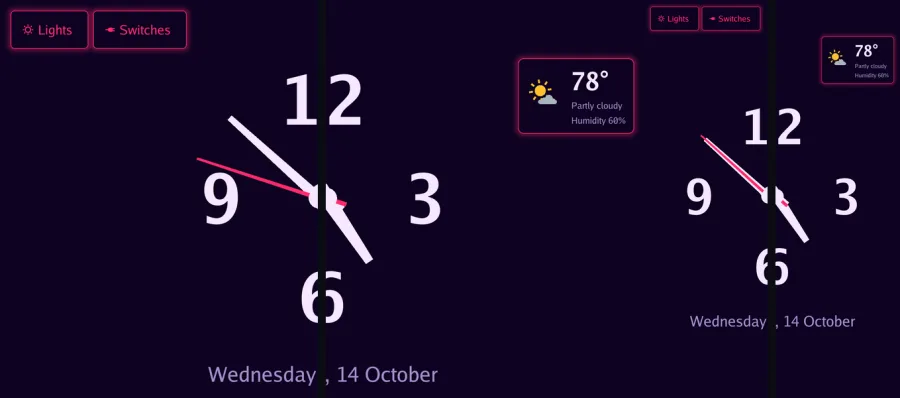
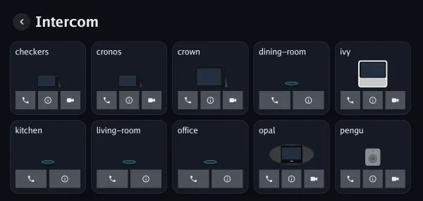
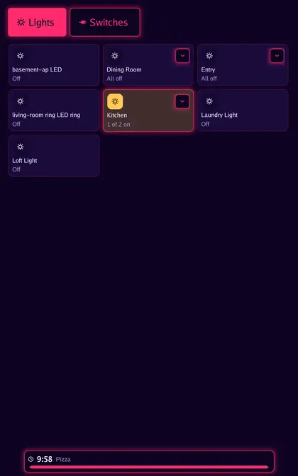
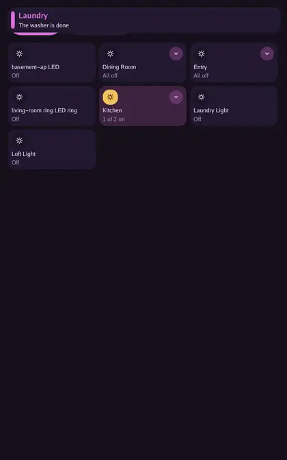
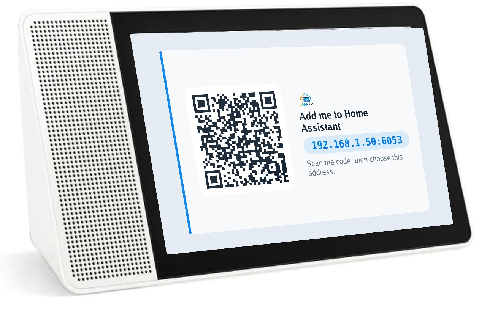

# LANovo

<a href="https://github.com/ygelfand/LANovo/stargazers"></a>
<a href="https://github.com/ygelfand/LANovo/releases"></a>
<a href="https://github.com/ygelfand/LANovo/releases/latest"></a>
<a href="https://buymeacoffee.com/ygelfand"></a>
<a href="https://discord.gg/efWnv89pg2"></a>
<a href="https://www.lanovo.link"></a>

Turn a Lenovo Smart Display into a local Home Assistant display, speaker and voice assistant.

A pure-Go replacement for what Lenovo and Google shipped. It speaks the ESPHome native API, so Home
Assistant discovers it the way it discovers any ESPHome device.

<p align="center">
  
</p>

## Devices

| Display | Codename | Status |
| --- | --- | --- |
| Lenovo Smart Display 10 | blueberry | Supported, portrait and landscape |
| Lenovo Smart Display 8 | amber | Portrait and landscape, untested |
| Lenovo Smart Display 7 | ivy | Supported, landscape |
| JBL Link View | opal | Supported, landscape |
| Lenovo ThinkSmart View | penghu | Supported, portrait and landscape |

## Features

### Visuals

33 audio visualizers, all GPU shaders at the screen's full resolution. Each one reacts to the
microphone, to what's playing, or both. Run one full screen or two side by side, on the screen
saver or for each voice assistant while it listens and answers. LCARS, HAL 9000,
a lava lamp, rain on glass, light cycles, four Pip-Boys, studio VU meters and more.

### Native dashboard

A clock in one of eight faces, the weather, and tabs for your Home Assistant lights and switches,
picked by area or label.

<p align="center">
  
  
</p>

### Tessera dashboards

LANovo speaks the [Tessera](https://github.com/MaxGramser/homeassistant_espscreen) screen protocol.
Lay out pages in Tessera's editor in Home Assistant and the display draws them. Most of Tessera's
tiles and features are supported.

<p align="center">
  
</p>

### Styles and themes

Nine styles (Standard, Material You, Glass, E-ink, Metro, Terminal, Hi-fi, Neon, Skeuo) and eighteen
color themes, applied to everything on the display, Tessera pages included.

### Rotation

The Smart Display 10, Smart Display 8 and ThinkSmart View rotate automatically. The
dashboards, settings, camera and everything else turn with them.

<p align="center">
  
</p>

### Voice

On-device wake words with [microWakeWord](https://github.com/kahrendt/microWakeWord) and
[openWakeWord](https://github.com/dscripka/openWakeWord). Two assistants, each with its own wake
word, Assist pipeline and visuals. "Stop" works without a wake word.

### Intercom

Audio and video calls between LANovo displays and EchoLocal devices on your network, with
auto-answer for the devices you choose.

<p align="center">
  
</p>

### Timers and messages

Six timer styles. Messages from Home Assistant in four tones and four styles, each with its own
chime, including custom sounds.

<p align="center">
  
  
</p>

### Audio

- A Home Assistant `media_player` for announcements, TTS and radio
- A Sendspin player for Music Assistant
- A Bluetooth speaker
- A Chromecast receiver for YouTube (with SponsorBlock), YouTube Music, YouTube TV, Prime Video and
  the default media receiver (experimental)

### Camera

An RTSP server on port 8554 with `main` and `sub` streams for Frigate, Blue Iris or similar, ONVIF
discovery, and a snapshot camera in Home Assistant. The physical shutter stops the camera.

### Also

- Bluetooth proxy for Home Assistant
- Proximity wake and adaptive brightness
- Night mode: dim, dim to a clock, or screen off when the room is dark
- Immich wallpaper
- Settings on the display or from Home Assistant, and config sync between displays
- Updates from Home Assistant or from the display, stable or development channel
- Apps: Intercom, Mirror, Shopping list, Calendar, Radar, more coming

## Installing

You need an unlocked display connected over USB. Follow the XDA guide for the
[Smart Display 8/10 and JBL Link View](https://xdaforums.com/t/lenovo-smart-display-8-10-amber-blueberry-avb-bootloader-unlock-firmware.4472049/)
or the
[Smart Display 7](https://xdaforums.com/t/cd-17302f-lenovo-smart-display-7-ivy-avb-bootloader-unlock-firmware.4472041/)
and flash the **Android 8.1 Debug Firmware**. For the ThinkSmart View, ask on
[Discord](https://discord.gg/efWnv89pg2).

Then download `lanovo` from the [releases page](https://github.com/ygelfand/LANovo/releases):

```sh
lanovo install --name kitchen
```

It checks the display, installs LANovo, and asks for your Wi‑Fi if the display isn't on a network
yet. It then shows up in Home Assistant, with a code on screen to pair it.

<p align="center">
  
</p>

The full guide is at [www.lanovo.link](https://www.lanovo.link).

## Building it yourself

```sh
make build             # lanovo, lanovod and its native helpers
make dist              # lanovod, then lanovo carrying it
make install-lanovod   # build, install, and restart it on a connected display
```

## How it fits together

- **lanovod** runs on the display: the screen, the audio, the camera, the radios, the wake word
  engines, the conversation, and an ESPHome native API server. It is one static Go binary with no
  cgo.
- **lanovo** is the host CLI: checking, installing, Wi‑Fi and pairing.
- **[libcountertop](https://github.com/ygelfand/libcountertop)** holds the features LANovo shares
  with [EchoLocal](https://github.com/ygelfand/echolocal).
- **[go-esphome-device](https://github.com/ygelfand/go-esphome-device)** implements the device half of
  the ESPHome protocol, including the voice satellite and Bluetooth proxy.

## License

AGPL-3.0. See [LICENSE](LICENSE).
