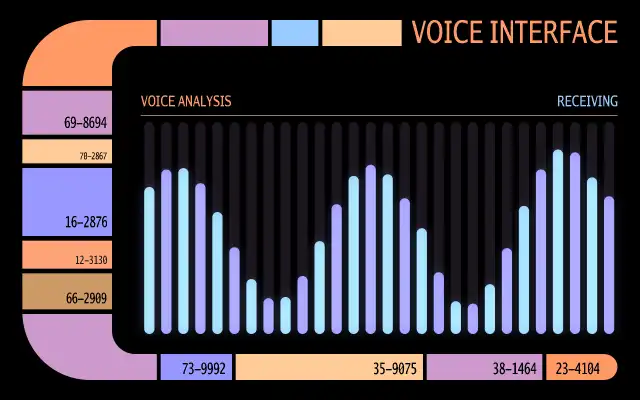
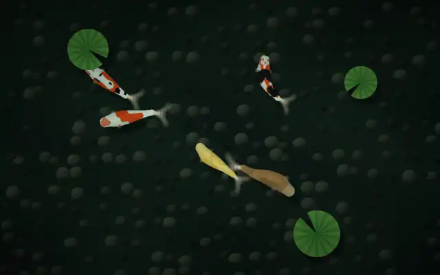
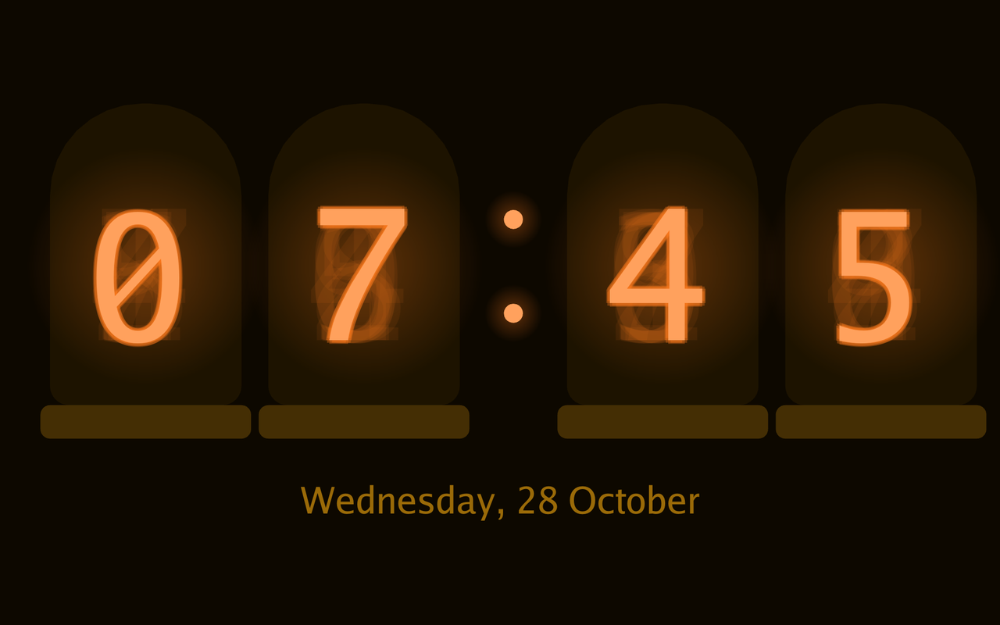
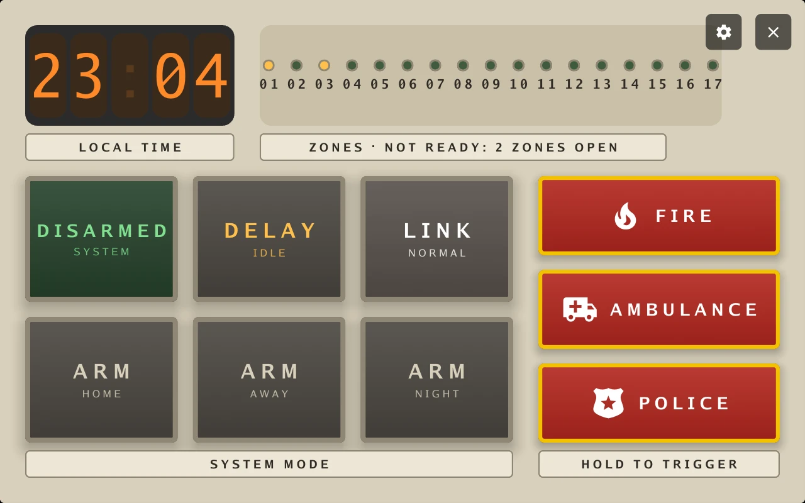
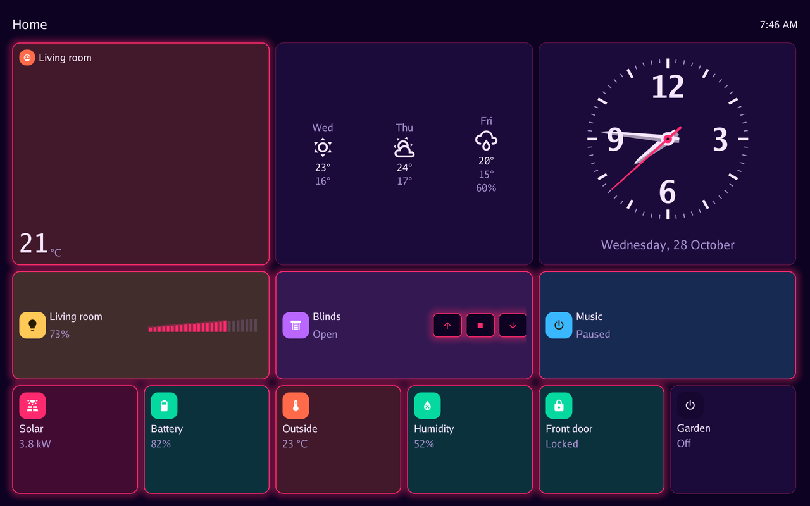
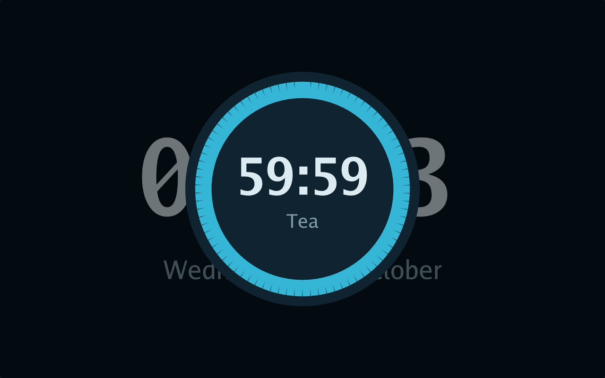
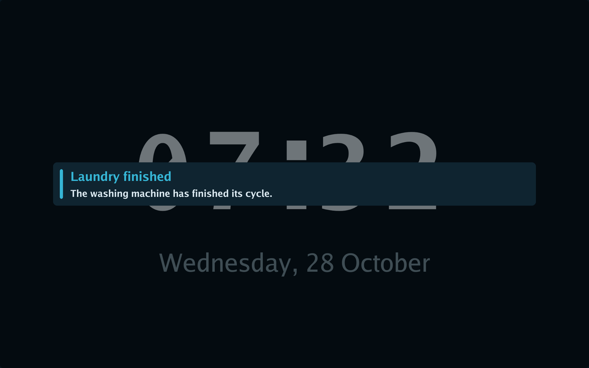

# LANovo

<a href="https://github.com/ygelfand/LANovo/stargazers"></a>
<a href="https://github.com/ygelfand/LANovo/releases"></a>
<a href="https://github.com/ygelfand/LANovo/releases/latest"></a>
<a href="https://buymeacoffee.com/ygelfand"></a>
<a href="https://discord.gg/efWnv89pg2"></a>
<a href="https://www.lanovo.link"></a>

An open-source replacement for Google Assistant on Lenovo Smart Displays, JBL Link View and
ThinkSmart View, with Home Assistant Assist, dashboards, apps, music and video calls.

Uses the display's existing microphones, speakers, camera and sensors. Home Assistant discovers it
through the ESPHome native API.

<p align="center">
  <a href="https://www.lanovo.link/use/visuals/"></a>
  <a href="https://www.lanovo.link/use/visuals/"></a>
  <a href="https://www.lanovo.link/use/visuals/"></a>
</p>

| Nixie clock | Hardware alarm panel |
|:---:|:---:|
|  |  |

| Tessera in Neon | Photos |
|:---:|:---:|
|  |  |

[Interface gallery](https://www.lanovo.link/use/gallery/) · [Setup guide](https://www.lanovo.link/start/devices/) · [Releases](https://github.com/ygelfand/LANovo/releases)

## Devices

| Device                  | Codename  | OS                 | Status    |
| ----------------------- | --------- | ------------------ | --------- |
| Lenovo Smart Display 10 | blueberry | Android Things 8.x | Supported |
| Lenovo Smart Display 8  | amber     | Android Things 8.x | Supported |
| Lenovo Smart Display 7  | ivy       | Android Things 8.x | Supported |
| JBL Link View           | opal      | Android Things 8.x | Supported |
| Lenovo ThinkSmart View  | penghu    | Android 8.x        | Supported |

## Additional devices supported by our sister project [EchoLocal](https://github.com/ygelfand/echolocal)

| Device                | Codename | OS          | Status    |
| --------------------- | -------- | ----------- | --------- |
| Echo Dot (2nd gen)    | biscuit  | Fire OS 6.x | Supported |
| Echo Show 5 (1st gen) | checkers | Fire OS 6.x | Supported |
| Echo Show 5 (2nd gen) | cronos   | Fire OS 6.x | Supported |
| Echo Show 8 (1st gen) | crown    | Fire OS 6.x | Supported |
| Echo Show 8 (2nd gen) | athena   | Fire OS 7.x | Supported |

## Features

### Visuals

33 audio visualizers, all GPU shaders at the screen's full resolution. Each one reacts to the
microphone, to what's playing, or both. Run one full screen or two side by side, on the screen
saver or for each voice assistant while it listens and answers. LCARS, HAL 9000,
a lava lamp, rain on glass, light cycles, four Pip-Boys, studio VU meters and more.

### Native dashboard

A clock in one of 21 faces, photo wallpaper, weather, and tabs for Home Assistant lights, switches,
cameras, doorbells and your alarm panel. Pick lights and switches by area, label or entity.

<p align="center">
  
</p>

### Tessera dashboards

Design pages in [Tessera](https://github.com/MaxGramser/homeassistant_espscreen) in Home Assistant.
Choose LANovo's native renderer or embedded Tessera firmware; both use the same layouts.

### Styles and themes

Nine styles (Standard, Material You, Glass, E-ink, Metro, Terminal, Hi-fi, Neon, Skeuo) and eighteen
color themes, applied to everything on the display, Tessera pages included.

### Rotation

The Smart Display 10, Smart Display 8 and ThinkSmart View rotate automatically. The
dashboards, settings, camera and everything else turn with them.

<p align="center">
  
</p>

### Voice

On-device wake words with [microWakeWord](https://github.com/kahrendt/microWakeWord) and
[openWakeWord](https://github.com/dscripka/openWakeWord). Two assistants, each with its own wake
word, Assist pipeline and visuals. "Stop" works without a wake word. Ask your assistant to call
another device or send a broadcast.

### Intercom

Audio and video calls between LANovo displays and EchoLocal devices on your network, with
auto-answer for the devices you choose. Call a display from a Home Assistant dashboard with the
[integration](#the-optional-integration). Broadcast a voice message to every device at once, and keep
devices outside your home out with a shared home key.

<p align="center">
  
</p>

### Timers and messages

Six timer styles. Messages from Home Assistant in four tones and four styles, each with its own
chime, including custom sounds.

<p align="center">
  
  
</p>

### Audio

- A Home Assistant `media_player` for announcements, TTS and radio
- A Sendspin player for Music Assistant
- A Bluetooth speaker
- A Chromecast receiver that runs each app's own receiver page, with SponsorBlock for YouTube
  (experimental)

### Camera

An RTSP server on port 8554 with `main` and `sub` streams for Frigate, Blue Iris or similar, ONVIF
discovery, and a snapshot camera in Home Assistant. The physical shutter stops the camera.

### Also

- Bluetooth proxy for Home Assistant
- Proximity wake and adaptive brightness
- Night mode: dim, dim to a clock, or screen off when the room is dark
- Photos from Immich and Google Photos, as wallpaper, a screen saver or a full-screen app
- Settings on the display or from Home Assistant, and config sync between displays
- Updates from Home Assistant or from the display, stable or development channel, and earlier
  versions to go back to
- A PIN lock for the settings menu
- Apps: Intercom, Cameras (live video and audio with the integration), Lights, Switches, Mirror,
  Shopping list, Calendar, Radar, more coming

### In a browser

Every display serves its own web page over HTTPS: a live view of the screen, every setting with
search, alarms, calls and broadcasts, and logs. Live screen control includes QR pairing and remote
keyboard input; portable settings can be exported and imported. Behind it is an HTTP API for scripts. The
certificate is self-signed, or comes from [Cert Warden](https://www.certwarden.com) if you run one.
See [In a browser](https://www.lanovo.link/use/web/).

## The optional integration

Everything above works with stock Home Assistant. The
[EchoLocal integration](https://github.com/ygelfand/echolocal-hacs) (HACS), shared with our sister
project, adds a card for each display with its screen drawn live, a dashboard with every display
and Echo, Fleet to compare settings across devices and copy them from one to the others, calls from
a dashboard, turn history with recordings, a wake word library, custom tones, groups and a health
view. See [The EchoLocal integration](https://www.lanovo.link/start/integration/).

## Installing

You need an unlocked display connected over USB. Follow the XDA guide for the
[Smart Display 8/10 and JBL Link View](https://xdaforums.com/t/lenovo-smart-display-8-10-amber-blueberry-avb-bootloader-unlock-firmware.4472049/)
or the
[Smart Display 7](https://xdaforums.com/t/cd-17302f-lenovo-smart-display-7-ivy-avb-bootloader-unlock-firmware.4472041/)
and flash the **Android 8.1 Debug Firmware**. For the ThinkSmart View, ask on
[Discord](https://discord.gg/efWnv89pg2).

Then download `lanovo` from the [releases page](https://github.com/ygelfand/LANovo/releases):

```sh
lanovo install --name kitchen
```

It checks the display, installs LANovo, and asks for your Wi‑Fi if the display isn't on a network
yet. It then shows up in Home Assistant, with a code on screen to pair it.

<p align="center">
  
</p>

The full guide is at [www.lanovo.link](https://www.lanovo.link).

## Building it yourself

```sh
make build             # lanovo, lanovod and its native helpers
make dist              # lanovod, then lanovo carrying it
make install-lanovod   # build, install, and restart it on a connected display
```

## How it fits together

- **lanovod** runs on the display: the screen, the audio, the camera, the radios, the wake word
  engines, the conversation, and an ESPHome native API server. It is one static Go binary with no
  cgo.
- **lanovo** is the host CLI: checking, installing, Wi‑Fi and pairing.
- **[libcountertop](https://github.com/ygelfand/libcountertop)** holds the features LANovo shares
  with [EchoLocal](https://github.com/ygelfand/echolocal).
- **[go-esphome-device](https://github.com/ygelfand/go-esphome-device)** implements the device half of
  the ESPHome protocol, including the voice satellite and Bluetooth proxy.

## License

AGPL-3.0. See [LICENSE](LICENSE).
